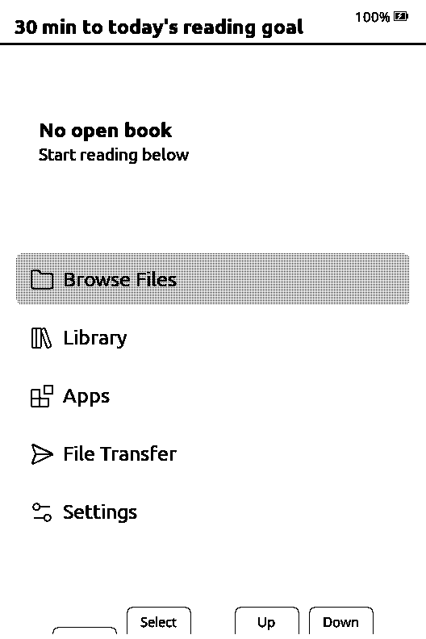
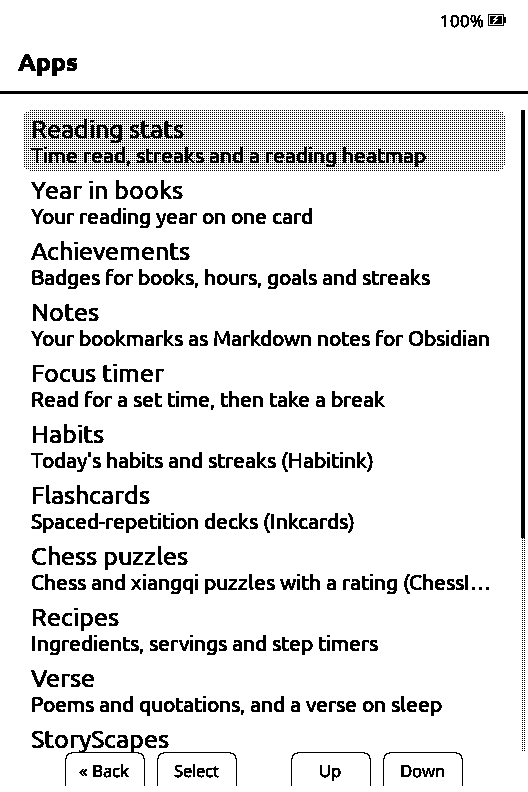
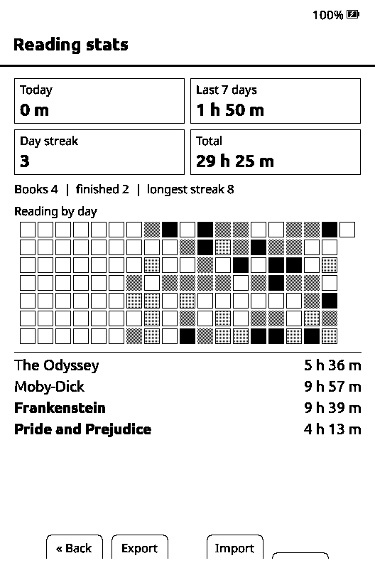
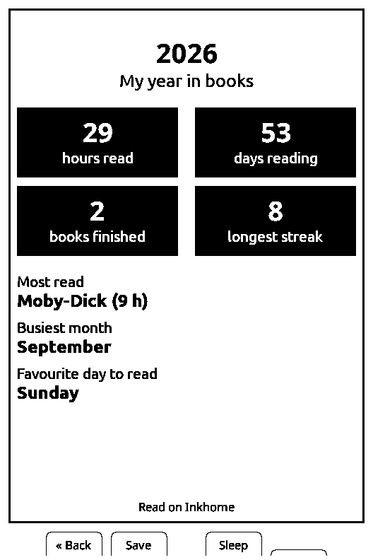
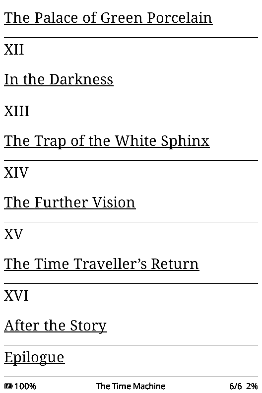
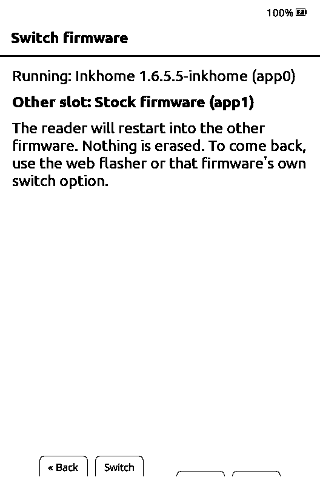
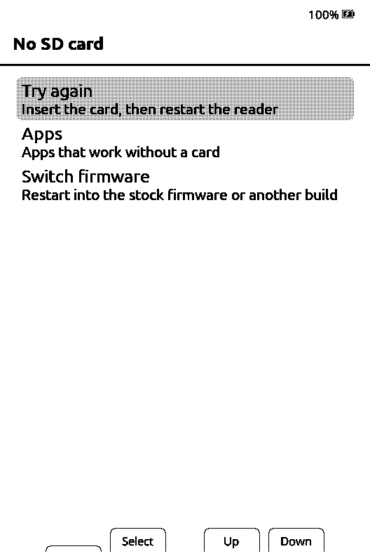
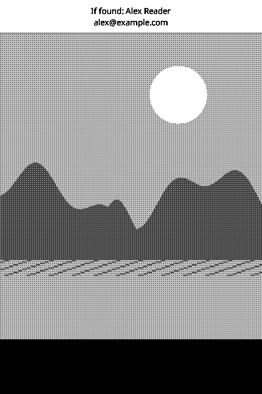
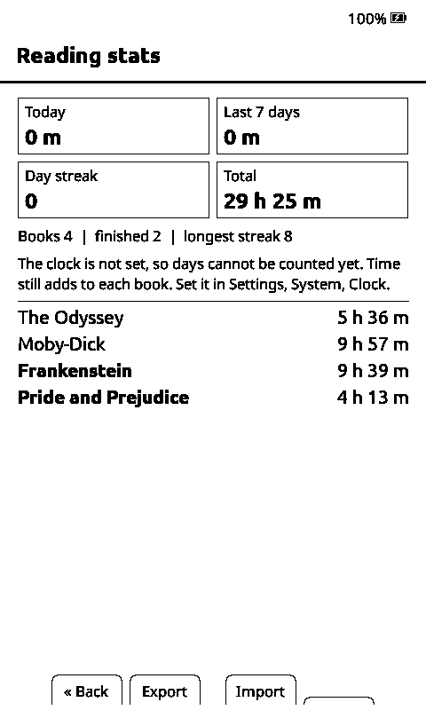

# Inkhome

Inkhome is an X3-first fork of [CrossPoint Reader](https://github.com/crosspoint-reader/crosspoint-reader)
for the Xteink X3 (and, unchanged, the X4). It keeps CrossPoint's reader and
adds a home for a small e-ink ecosystem: native on-device **Apps**, the X3's
motion sensor as a first-class feature, and a flasher that installs Inkhome
**beside the stock firmware** so you can switch back at any time.

**Install from your browser:** [mohitagw15856.github.io/inkhome](https://mohitagw15856.github.io/inkhome/)
(Chrome or Edge on a computer). No downloads, no building, and the stock
firmware stays on the device.

> Status: early. Every screen is built, unit tested and driven with scripted
> button presses in the CrossPoint simulator at X3 and X4 size. It has **not
> yet been verified on a physical device**; the checklist is in
> [docs/inkhome/TESTING.md](docs/inkhome/TESTING.md).

<table>
  <tr>
    <td align="center"><br><sub>Home</sub></td>
    <td align="center"><br><sub>Apps</sub></td>
    <td align="center"><br><sub>Reading stats</sub></td>
    <td align="center"><br><sub>Year in books</sub></td>
  </tr>
  <tr>
    <td align="center"><br><sub>Cover + stats sleep</sub></td>
    <td align="center"><br><sub>Your stock pictures</sub></td>
    <td align="center"><br><sub>Custom + stats sleep</sub></td>
    <td align="center"><br><sub>Verse sleep</sub></td>
  </tr>
  <tr>
    <td align="center"><br><sub>Time left in chapter</sub></td>
    <td align="center"><br><sub>Recipes</sub></td>
    <td align="center"><br><sub>Cooking mode</sub></td>
    <td align="center"><br><sub>Chess puzzles</sub></td>
  </tr>
  <tr>
    <td align="center"><br><sub>Switch to stock</sub></td>
    <td align="center"><br><sub>No SD card needed</sub></td>
    <td align="center"><br><sub>Owner details on sleep</sub></td>
    <td align="center"><br><sub>Same build on the X4</sub></td>
  </tr>
</table>

<sub>Screens rendered from the real firmware with
[crosspoint-simulator](https://github.com/crosspoint-reader/crosspoint-simulator)
at the X3's 528 x 792 portrait size (X4 images: 480 x 800). Book titles and
reading history in them are sample data.
Regenerate with `scripts/inkhome/screenshots.sh`.</sub>

## What it adds

- **Keep stock, switch any time.** The web flasher identifies the stock
  firmware and installs Inkhome into the *other* slot. Switch back from the
  reader (Apps, Switch firmware) or from the flasher page. Inkhome's own
  Wi-Fi and SD updaters refuse to overwrite stock.
- **No SD card required.** Without a card Inkhome opens a small menu (try
  again, Apps, Switch firmware) instead of stopping on an error screen.
- **Reading stats**, compatible with CPR-vCodex's `reading_stats.json`:
  today, last 7 days, streak and total, a reading heatmap sized to the panel,
  and time per book. Import and export use vCodex's `/exports/stats_exported`.
- **Apps.** A launcher on Home and a small framework (`src/apps/`) where each
  app is a self-contained module with its own SD folder.
  - **Habits** (Habitink): today's habits with tick boxes and streaks, in
    Habitink's own files, and optionally along the bottom of the sleep screen.
  - **Flashcards** (Inkcards): spaced-repetition decks with SM-2 scheduling;
    the demo and world capitals decks are built in. A **Flashcard** sleep
    screen shows the next card of your last deck each time the reader sleeps.
  - **Chess puzzles** (ChessInk): chess and xiangqi puzzles with legal-move
    dots, a rating and a streak; xiangqi uses real Chinese piece glyphs.
  - **StoryScapes**: illustrated history packs, text reflowed for the panel and
    picture pages streamed from the card (landscape plates turned to fit).
  - **Recipes** (InkRecipes): ingredient checklist with a servings scaler and
    a cooking mode with large type and step timers. Includes a built-in recipe.
  - **Verse** (InkVerse): poems and quotations one at a time, and a **Verse**
    sleep screen that shows the next one each time the reader sleeps. Two
    public-domain collections built in.
  - **Year in books**: hours, days, finished books, longest streak, most-read
    book and favourite day on one card, saved as a picture or a sleep screen.
  - **Achievements**: 62 badges for books, hours, daily goals and streaks,
    compatible with CPR-vCodex's `achievements.json`.
  - **Notes**: your bookmarks as Markdown files in `/notes/inkhome/`, ready for
    Obsidian; the current book's file refreshes whenever the reader sleeps.
  - **Focus timer**: read for 15 to 60 minutes, then a break screen.
  - **If Found**: shows your contact note so a lost reader can find its way home,
    and can put it across the top of every sleep screen.
  - **Battery health** (X3): capacity, charge cycles and health from the
    battery gauge, with a daily chart.
  - **Motion sensor** (X3): live readings, plus experimental shake to bookmark
    and face down to sleep (off until you turn them on).
  - **Switch firmware**: restarts into the stock firmware.
- **Tilt page turn on by default** on the X3 when its QMI8658 sensor is
  detected. Turn it off in Settings, Controls. The X4 has no sensor and is
  unaffected.
- **Your sleep wallpaper stays.** The Custom sleep screen (your images in
  `/sleep` or `/.sleep`) is unchanged, and it now also shows Xteink's own
  `.xth`/`.xtg` pictures in greyscale, including everything you sent to the
  reader with the stock app (the `/Pushed Images` folder on the card). A new **Custom + stats** mode shows the
  same wallpaper with a small reading card.
- **Updates come from Inkhome.** The updater looks for Inkhome releases, so a
  fork build is never "updated" back to stock CrossPoint by accident.

The plan and roadmap are in [PLAN.md](PLAN.md); scope rules in [SCOPE.md](SCOPE.md).

## Install

1. Open **[the Inkhome flasher](https://mohitagw15856.github.io/inkhome/)** in Chrome or Edge.
2. Connect the reader with a USB-C data cable, wake it, press **Connect**.
3. The page lists both firmware slots and says exactly what it will do.
   Press **Install or update Inkhome**.
4. Unplug the cable and hold Power for about two seconds.

To go back to stock, use **Start stock firmware** on the same page, or on
the reader open Apps, Switch firmware. To update Inkhome later, run Install
again: it updates Inkhome in place and keeps stock.

Not on stock any more, or the page cannot find a two-slot layout? See
CrossPoint's [recovery guide](docs/fix-bricked-xteink.md).

## X3 first, X4 safe

- One binary for both devices; the device is detected at start-up using
  upstream's runtime detection (`gpio.deviceIsX3()`).
- No screen sizes are hard-coded. Every screen lays out from the renderer's
  width and height, is designed for the X3's 792 x 528 panel first and
  checked against the X4's 800 x 480.
- The ESP32-C3 has no PSRAM. Apps allocate on entry, free on exit, cap the
  size of files they read and keep state on the card under `/.crosspoint/`.
- Release image: 5.6 MB, 85.6% of the 6.25 MB slot, so it fits the X4's
  stock slots as well as the X3's larger ones ([sizes](docs/inkhome/SIZES.md)).

## Building it yourself

```sh
git clone --recursive https://github.com/mohitagw15856/inkhome.git
cd inkhome
pio run -e gh_release              # release build: .pio/build/gh_release/firmware.bin
pio run -t unit-tests              # host tests, including test/inkhome
node --test test/inkhome/flasher.test.mjs
scripts/inkhome/screenshots.sh     # simulator screenshots and button smoke test
```

Writing an app: [docs/inkhome/APPS.md](docs/inkhome/APPS.md). Merging a new
upstream release: [docs/inkhome/UPSTREAM_SYNC.md](docs/inkhome/UPSTREAM_SYNC.md).

## Versioning

`<upstream-version>.<n>-inkhome`, for example `1.6.5.1-inkhome` is the first
Inkhome release on top of CrossPoint 1.6.5. Release tags match the version.

## Your data

Inkhome keeps CrossPoint's `/.crosspoint/` layout. Apps keep user content in
`/apps/<app>/` and state in `/.crosspoint/apps/<app>/`. Reading stats live in
`/.crosspoint/reading_stats.json` in CPR-vCodex's format, so you can copy a
vCodex file across (or import `/exports/stats_exported`) and back.

## Credits

- **CrossPoint Reader**, the CrossPoint Reader organisation and contributors
  (MIT). Inkhome is their firmware with additions; the upstream README is
  kept at [docs/UPSTREAM_README.md](docs/UPSTREAM_README.md).
- **CPR-vCodex** by franssjz (MIT): If Found is ported from vCodex, and the
  reading-stats format and design follow vCodex. vCodex in
  turn credits zgredex and erickosanchezj (Lyra Carousel), uxjulia and
  CrossInk (highlights) and the crosspet fork (text darkness).
- **crosspoint-tools** by SoFriendly (MIT): the flasher's partition and boot
  record handling. **esptool-js** by Espressif (Apache-2.0).
- **crosspoint-simulator** by Julia Nguyen (MIT): screenshots and smoke tests.
- **FreeInk SDK** (MIT), the hardware layer CrossPoint is built on.
- **inkkit apps** by Mohit (MIT): InkRecipes and the rest of the ecosystem.

Inkhome does not include vCodex's built-in Bookerly font, which is not
openly licensed, and does not host Xteink's stock firmware.

## Licence

MIT, see [LICENSE](LICENSE). The CrossPoint copyright notice is preserved;
fork additions are copyright Mohit and contributors under the same licence.
